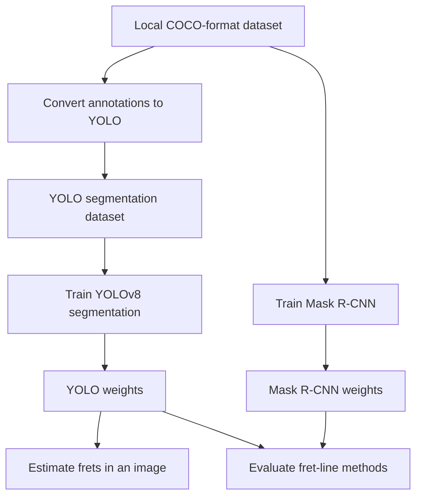

# Guitar CV AMT

This repo contains the ongoing computer-vision work from the [AIM Lab](https://ai4musicians.org/) automatic music transcription group. The repository contains building blocks for finding a guitar fretboard in an image or video, turning it into a consistent top-down view, estimating fret positions, and exploring hand-motion and chord-candidate ideas.

Most of the work here is still a WIP.

## Evidence-constrained fretboard atlas

The new `main.video.fretboard.rectify_atlas` workflow fits the **internal fret/string grid**
before resampling a playing frame into a standard 1024 x 256 rectangle. It
compares YOLO and Mask R-CNN proposals, detects real wires, checks relative
equal-temperament spacing, and uses an invertible cell mesh. Six strings map to
fixed rows; supported fret intervals can be made equal width. See the
[method analysis and limitations](research/fretboard_atlas.md).

```bash
uv run --extra visual -- python -m main.video.fretboard.rectify_atlas --image main/assets/fretboard/guitar_test_clean.png --output-dir output/atlas

# Use an existing mask without loading any neural model.
uv run --extra visual -- python -m main.video.fretboard.rectify_atlas --image frame.png --mask mask.png --output-dir output/atlas

# Faster single-model proposal path; default uses both bundled checkpoints.
uv run --extra visual -- python -m main.video.fretboard.rectify_atlas --image frame.png --yolo-only --output-dir output/atlas

# Reproduce the synthetic comparison against the existing PCA warp.
uv run --extra visual -- python -m main.evaluation.fretboard.benchmark_rectification --output-dir output/atlas-benchmark
uv run --with pytest -- pytest -q
```

Outputs include `rectified.png`, a separate `grid_overlay.png`, `source_grid.png`,
`geometry.json`, `mapping.npz`, and an in-frame validity mask. An optional
`--occlusion-mask hand.png` adds a visibility mask. `quality.status="coarse"`
means there was insufficient internal evidence: the output is only a crop
preview. Absolute fret numbers, nut direction, and string pitches remain
unknown without an anchor. Existing PCA scripts and the Gradio demo remain
available as the historical baseline.

## What is here

| Goal | Existing implementation |
| --- | --- |
| Find a fretboard | Mask R-CNN and YOLOv8 segmentation training and inference workflows |
| Estimate fret positions | Geometric PCA + perspective-warp method that projects 21 expected fret lines from a fretboard mask |
| Compare approaches | Evaluation of Mask R-CNN and optional YOLO masks across six fret-line methods |
| Explore related ideas | Canonicalization, FFT chord-candidate, webcam hand-tracking, and strum/pick demos |

The importable source package is grouped under [`main/`](main/) by domain:
audio transcription, video/fretboard and hand workflows, training, evaluation,
models, assets, and frozen deprecated experiments.

## Quick start: estimate frets in one image

1. Install the [Git LFS](https://git-lfs.com/) command-line tool before cloning when possible. If the repository is already cloned, the `git lfs install` and `git lfs pull` commands below fetch the bundled checkpoints.
2. Sync the project environment with [uv](https://docs.astral.sh/uv/):

   ```bash
   uv sync
   git lfs install
   git lfs pull
   ```

   The optional `visual` and `transcription` dependency groups are added on the
   commands below. If the `torch` installation needs CUDA or another
   accelerator-specific build, follow the appropriate [PyTorch instructions](https://pytorch.org/get-started/locally/)
   before running the relevant `uv` command.

3. Run the existing YOLO model on a guitar image:

   ```bash
   uv run --extra visual -- python -m main.video.fretboard.fret_detect_yolo \
     --image path/to/guitar.jpg \
     --visualize \
     --output result.png
   ```

   This command uses `main/models/fretboard/yolo_weights_best.pt` by default. It draws the inferred fretboard mask and estimated fret lines on `result.png`.

## Transcribe a performance video

[`main/audio/video_to_score.py`](main/audio/video_to_score.py) accepts a local video
or a single YouTube video URL, transcribes its audio with MT3-Infer, and saves a
WAV, MIDI, six-line ASCII guitar tablature, and editable MusicXML score. FFmpeg
must be installed and available on `PATH`.

The current MT3-Infer release requires Python 3.10 or newer. This repository's
default `.python-version` is 3.9, so ask `uv` to use 3.10 for this command and
include the optional `transcription` dependencies:

```bash
uv run --python 3.10 --extra transcription -- python -m main.audio.video_to_score "https://www.youtube.com/watch?v=VIDEO_ID"
```

The first run installs the dependencies and downloads the default MR-MT3
checkpoint. For a YouTube URL, the audio is downloaded temporarily and the
output folder is named `<YouTube-ID>_transcription/` in the current directory.
For a local video, outputs go into `<video-name>_transcription/` beside it.
YouTube playlists are not supported; provide a link to one video.

Choose a different model, device, or output directory as needed:

```bash
uv run --python 3.10 --extra transcription -- python -m main.audio.video_to_score "https://youtu.be/VIDEO_ID" \
  --model mt3_pytorch --device cuda \
  --output-dir output/performance
```

The output directory contains `audio.wav`, `transcription.mid`,
`tablature.txt`, and `sheet.musicxml`. Open the MusicXML file in a notation
editor such as MuseScore to review or print the score. The generated
tablature uses standard tuning (low-to-high MIDI E2/A2/D3/G3/B3/E4) and emits
six conventional lines in high-to-low display order:

```text
e|0-12-|
B|-----|
G|-----|
D|-----|
A|-----|
E|-----|
```

Each onset event occupies one aligned column. Columns are at least two
characters wide and expand for two-digit frets; systems contain at most 16
events and are separated by a blank line. Notes whose rounded MIDI pitch
cannot be played on a standard-tuned string at fret 0--24 are omitted, as are
excess notes when a simultaneous event needs more than six strings. Drum MIDI
tracks are ignored. The MIDI transcription does not contain guitar fingering, so
the deterministic assignment favors compact positions and smooth transitions but
is not a guarantee of the performer's fingering. Near-simultaneous onsets (within
50 ms) are treated as one chord event.

Pass `--overwrite` to replace outputs already in the chosen directory,
including `tablature.txt`.

### Evaluate an audio-only baseline

The fixed GuitarSet subset evaluator reports framewise active-pitch metrics and
exact string/fret tab metrics. Run the same eight clips with each supported
MT3-Infer model; outputs and cached MIDI are kept separate by model:

```bash
uv run --python 3.10 --extra transcription -- \
  python -m main.evaluation.audio.evaluate_mt3_guitarset_framewise --model yourmt3
```

Use `--model mr_mt3` or `--model mt3_pytorch` for the other baselines. YourMT3
inference currently requires Transformers 4.44.x; the transcription extra pins
that compatible range. Results are an audio-only GuitarSet baseline, not an
evaluation of video fusion.

### Optional audio-first visual fingering

Visual analysis is opt-in and is available for local videos only.  Use Python
3.10 with both optional dependency groups:

```bash
uv run --python 3.10 --extra transcription --extra visual -- \
  python -m main.audio.video_to_score path/to/performance.mp4 \
  --visual --output-dir output/performance
```

Visual mode always transcribes audio first.  MIDI pitch and onset timing remain
authoritative; YOLO fretboard masks, EFA (`rectify_fretboard`), and MediaPipe
Hands extract continuous fingertip **string rows** and test only two possible
top-to-bottom row orders (standard-string order or its reverse).  The visual
row choice and the authoritative MIDI pitch determine an exact playable
`(string, fret)` candidate: the fret is derived as
`pitch_midi - open_string_pitch`, never inferred from an EFA cell coordinate.
The existing whole-chord, unique-string dynamic program then ranks those exact
candidates. The normal outputs are joined by `audio_tablature.txt` (the
unchanged audio-only baseline), `visual_diagnostics.json`, and
`visual_overlay.mp4`. The overlay keeps the source audio and timeline while
sampling visual detections at 5 fps. It draws the observed fret/string grid
and MediaPipe fingertips, including when the grid is unavailable. Only accepted
visual evidence may change `tablature.txt`; acceptance also requires the final
whole-chord assignment to select at least one exact position with positive
visual evidence.

To include the diagram's **finger position → note region** step, provide a
calibration for the same local video:

```bash
uv run --python 3.10 --extra transcription --extra visual -- \
  python -m main.audio.video_to_score path/to/performance.mp4 \
  --model yourmt3 --visual --visual-calibration path/to/calibration.json \
  --output-dir output/performance
```

The JSON uses the `BoardCalibration` format: `corners` are the nut at the top
string, a numbered wire at the top string, that wire at the bottom string, and
the nut at the bottom string, in that order. Set `far_fret` to the numbered
wire (1–24), `top_string` to 6 for low E or 1 for high E, and `reference_frame`
to the video frame used for those corners (default 0). An optional `image_size`
is `[width, height]`. For example:

```json
{
  "corners": [[1487, 780], [940, 676], [927, 750], [1475, 837]],
  "far_fret": 12,
  "top_string": 6,
  "reference_frame": 0,
  "image_size": [1920, 1080]
}
```

These corner coordinates are an illustration; measure them on the video's
reference frame. The existing `main.video.fretboard.video_fusion` command
can create a calibration interactively and save it as `calibration.json`.
The calibration must use standard tuning. The pipeline tracks its board into
each sampled frame using optical flow for small moves and feature matching for
larger jumps. A nearby accepted frame can bridge a short tracking failure.
The tracked board maps fingertips to numbered fret regions, and requires a
visual contact to match both the string row and the MIDI-implied fret. Contacts
too close to a fret wire or from a frame whose board cannot be tracked are
discarded. If no usable visual assignment remains, the final TAB falls back to
the audio-only output.
`visual_diagnostics.json` records the tracking method and matching results.
Without calibration, the existing string-row workflow remains available.

EFA quality summaries retain `lattice_accepted` as observed geometry metadata,
but string-row evidence does not require that lattice flag.  EFA still supplies
no absolute fret number, nut direction, or pitch/string label.

If the video, model, hand landmarks, or semantic alignment is unavailable or
ambiguous, the default is an honest fallback: `tablature.txt` is byte-for-byte
the baseline and diagnostics records the observed failure or quality status.
`--require-visual` turns that fallback into an error.  `--visual` rejects
YouTube URLs before download; YouTube remains audio-only.  `--overwrite`
protects all enabled outputs, including both tablature files and diagnostics.

For a quick iteration on the first 15 seconds of the bundled Stairway video:

```bash
ffmpeg -y -i videos/stairway-intro.webm -t 15 -map 0:v:0 -map 0:a:0 \
  -c:v libx264 -preset fast -crf 22 -pix_fmt yuv420p \
  -c:a aac -b:a 160k videos/stairway-intro-short.mp4
uv run --python 3.10 --extra transcription --extra visual -- \
  python -m main.audio.video_to_score videos/stairway-intro-short.mp4 \
  --model yourmt3 --visual --output-dir output/stairway-intro-short --overwrite
```

Open `output/stairway-intro-short/visual_overlay.mp4` beside the two TAB files.

The bundled YOLO checkpoint (`main/models/fretboard/yolo_weights_best.pt`) and MediaPipe
Tasks model (`main/models/hands/hand_landmarker.task`) are repository-relative defaults.
Fetch large files with Git LFS (`git lfs install && git lfs pull`), and install
FFmpeg on `PATH` for audio extraction.  A static, well-lit frame with a clear
fretboard and visible fretting fingers is the most favorable case; occlusion,
motion blur, unusual camera angles, left-handed instruments, missing model
files, and unsupported MediaPipe/Ultralytics runtimes can all cause fallback.

## GuitarSet benchmark tab comparisons

The fixed eight-clip MT3 benchmark writes its metrics to
[`research/mt3_guitarset_framewise_f1.md`](research/mt3_guitarset_framewise_f1.md)
and its aligned ground-truth versus generated tab systems to
[`research/mt3_guitarset_tab_comparisons.md`](research/mt3_guitarset_tab_comparisons.md).
Use `--comparisons PATH` with
`uv run --python 3.10 --extra transcription -- python -m main.evaluation.audio.evaluate_mt3_guitarset_framewise`
to choose a different comparison report location.


## Active workflow



### 1. Provide the dataset

The repository does not contain training data. The active scripts expect a local COCO-style dataset at `main/data/fretboard/coco/`:

```text
main/data/fretboard/coco/
├── train/
│   ├── _annotations.coco.json
│   └── image files
├── valid/
│   ├── _annotations.coco.json
│   └── image files
└── test/                         # optional for conversion; used when evaluating
    ├── _annotations.coco.json
    └── image files
```

The local dataset, converted YOLO dataset, and YOLO training-run directory are intentionally ignored by Git. The COCO annotations need image names, polygon segmentations, and bounding boxes for the configured fret/fret-zone categories.

### 2. Prepare and train a segmentation model

**YOLOv8 path** — convert the COCO annotations, then train:

```bash
uv run --extra visual -- python -m main.training.fretboard.convert_coco_to_yolo
uv run --extra visual -- python -m main.training.fretboard.train_yolo
```

- Conversion creates `main/data/fretboard/yolo/`, removes any previous version of that directory, and makes symlinks to the source images. On Windows, symlink creation may require Developer Mode or elevated permissions.
- YOLO training reads `main/data/fretboard/yolo/dataset.yaml`, writes run files to `main/data/fretboard/yolo_runs/`, and copies the selected model to `main/models/fretboard/yolo_weights_best.pt`.
- Optional training controls are available, for example:

  ```bash
  uv run --extra visual -- python -m main.training.fretboard.train_yolo --model yolov8s-seg --epochs 100 --imgsz 640 --batch 8
  ```

**Mask R-CNN path** — train directly from the COCO dataset:

```bash
uv run --extra visual -- python -m main.training.fretboard.train_mask
```

This writes `main/models/fretboard/model_weights_new.pt`. The existing
`main/models/fretboard/model_weights.pt` is the default Mask R-CNN checkpoint
used by the evaluator; do not use either Mask R-CNN file with the YOLO training commands.

### 3. Estimate frets from an image

[`main/video/fretboard/fret_detect_yolo.py`](main/video/fretboard/fret_detect_yolo.py) first predicts a fretboard segmentation mask. It then cleans that mask, estimates the fretboard corners with PCA, warps the board to a standard rectangle, and uses the Rule of 18 to project up to 21 fret positions back onto the original image.

This is a geometry-based estimate from the fretboard mask. It does **not** independently detect every physical fret wire in the image.

```bash
uv run --extra visual -- python -m main.video.fretboard.fret_detect_yolo \
  --image path/to/guitar.jpg \
  --weights main/models/fretboard/yolo_weights_best.pt \
  --visualize --output result.png
```

### 4. Explore interactively

```bash
uv run --extra visual -- python -m main.video.fretboard.gradio_demo
```

The demo exposes the annotated input image, the top-down rectified fretboard,
and the machine-readable JSON detection result. The same outputs are available
from the command-line detector; use `--json` for JSON output and
`--rectified-output` to save the warped fretboard image:

```bash
uv run --extra visual -- python -m main.video.fretboard.fret_detect_yolo \
  --image path/to/guitar.jpg \
  --json results.json
uv run --extra visual -- python -m main.video.fretboard.fret_detect_yolo \
  --image path/to/guitar.jpg \
  --rectified-output rectified.png \
  --visualize --output annotated.png

# Save all three CLI outputs in one run: annotated image, rectified image, JSON.
uv run --extra visual -- python -m main.video.fretboard.fret_detect_yolo \
  --image path/to/guitar.jpg \
  --visualize --output annotated.png \
  --rectified-output rectified.png \
  --json results.json
```

### 5. Evaluate the approaches

[`main/evaluation/fretboard/evaluate_all.py`](main/evaluation/fretboard/evaluate_all.py) measures segmentation quality and runs six fret-line estimation methods on the available `valid` and `test` splits. It always evaluates a Mask R-CNN checkpoint and can optionally evaluate YOLO as well:

```bash
uv run --extra visual -- python -m main.evaluation.fretboard.evaluate_all \
  --weights main/models/fretboard/model_weights_new.pt \
  --yolo-weights main/models/fretboard/yolo_weights_best.pt
```

The command overwrites `research/fretboard/evaluation_results.csv` with the latest results.

## Source and artifact layout

All importable source modules live under [`main/`](main/) and are grouped by
domain. Training data and generated runs are kept under `main/data/`; model
checkpoints are under `main/models/`; generated research records are under
`research/fretboard/`.

| Stage | Files | Purpose |
| --- | --- | --- |
| Data preparation | `main/training/fretboard/convert_coco_to_yolo.py` | Converts annotated COCO splits into a one-class YOLO segmentation dataset |
| Training | `main/training/fretboard/train_yolo.py`, `main/training/fretboard/train_mask.py` | Trains YOLOv8 segmentation or Mask R-CNN from the local dataset |
| Inference | `main/video/fretboard/fret_detect_yolo.py` | Segments a guitar fretboard and estimates fret positions in one image |
| Evaluation | `main/evaluation/fretboard/evaluate_all.py`, `research/fretboard/evaluation_results.csv` | Compares models and fret-line methods, then records metrics |
| Model artifacts | `main/models/fretboard/yolo_weights_best.pt`, `main/models/fretboard/model_weights.pt`, `main/models/fretboard/model_weights_new.pt` | Checkpoints tied to their respective YOLO or Mask R-CNN workflows |
| Recorded analysis | `research/fretboard/yolo_comparison_results.md` | Summary of the stored Mask R-CNN versus YOLO experiment |

## Other parts of the repository

| Location | Contents | When to use it |
| --- | --- | --- |
| [`notebooks/`](notebooks/) | Canonicalization, FFT chord-candidate, and template notebooks | Explore experiments interactively |
| [`main/video/fretboard/`](main/video/fretboard/) | Fretboard geometry, rectification, Gradio, and video demos | Run image and video fretboard workflows |
| [`main/video/hands/`](main/video/hands/) | Visual fingering and hand-landmark demos | Try local-video or live-camera hand analysis |
| [`binder/`](binder/) | Binder-specific setup and dependencies | Build the hosted notebook environment |
| [`main/deprecated/`](main/deprecated/) | Frozen legacy experiments | Reference only; not part of the active workflow |
| `Untitled0.ipynb` | Empty historical Colab stub | Not part of the supported workflow |

### Interactive notebooks

- [Canonical fretboard notebook](notebooks/canonical_fretboard.ipynb)
- [FFT chord-candidate notebook](notebooks/fft_chord_candidates.ipynb)

The notebook and webcam demos are exploratory tools, not a complete chord-recognition or transcription system.

## Existing experiment results

The stored [YOLO vs. Mask R-CNN comparison](research/fretboard/yolo_comparison_results.md) and [detailed CSV metrics](research/fretboard/evaluation_results.csv) record results from one local experiment. They are useful for understanding the tested models and fret-line methods, but should not be treated as a general performance guarantee because the dataset, hardware, and broader evaluation protocol are not distributed here.

## New Members

For the research context behind fretboard, fingertip, string, and pressed-versus-hovering-finger detection, see:

- [Duke & Salgian (2019)](https://doi.org/10.1007/978-3-030-33723-0_20) — Purdue access may be required; the paper begins on page 248 (PDF page 267).
- [Asmar (2022)](https://publications.polymtl.ca/10470/1/2022_MarkAsmar.pdf)
- [Ghaleb et al. (2024)](https://arxiv.org/abs/2409.08618)
